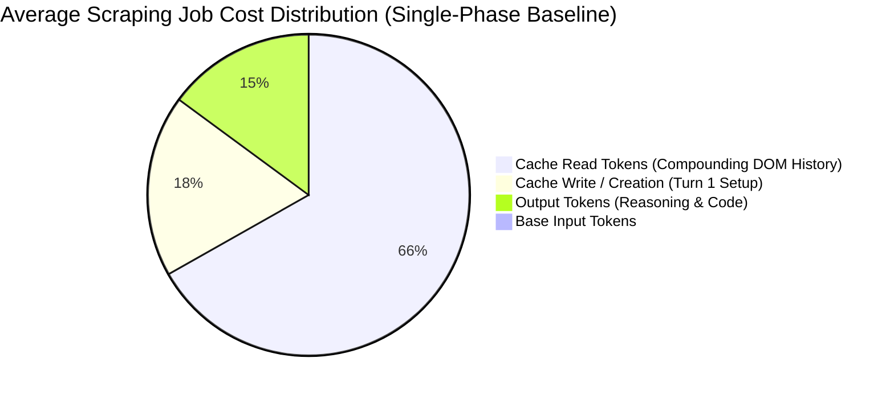

# 📊 Scraper Studio — Cost Computation & Frontier Model Comparison Report

> **Author:** Architecture & Cost Engineering Team  
> **Date:** August 28, 2026  
> **Status:** Production Reference Document  
> **Target Systems:** Scraper Studio (`inspection_agent_service.py`, `cost_metering.py`)

---

## Executive Summary

This report provides a comprehensive financial and architectural evaluation of **Scraper Studio's** token economy and agent cost dynamics. It breaks down the mathematical cost formulation, demonstrates empirical ledger findings from live test runs, compares frontier model families (**OpenAI GPT-5.6 Sol / Terra / Luna** vs. **Anthropic Claude Opus 5 / Sonnet 5 / Haiku 4.5**), and outlines a strategic transition plan to reduce per-job scraping generation costs by **up to 90%**.



---

## 1. Cost Computation Architecture & Mechanics

Scraper Studio computes per-job spend directly from the Anthropic Claude Agent SDK's `ResultMessage` schema via `cost_metering.py`.

### 1.1 The Formal Billing Formulation

$$\text{Total Cost (USD)} = \sum_{i \in \text{phases}} \left[ \frac{T_{\text{in}}^{(i)} \cdot P_{\text{in}}}{10^6} + \frac{T_{\text{cw}}^{(i)} \cdot P_{\text{cw}}}{10^6} + \frac{T_{\text{cr}}^{(i)} \cdot P_{\text{cr}}}{10^6} + \frac{T_{\text{out}}^{(i)} \cdot P_{\text{out}}}{10^6} \right]$$

### 1.2 Token Parameter Breakdown

| Token Parameter | Definition | Multiplier / Discount Rate | Function in Scraper Studio |
| :--- | :--- | :---: | :--- |
| **$T_{\text{in}}$ (Input Tokens)** | Fresh, uncached prompt tokens | $1.0\times$ Base Rate | Initial task prompt instructions and user rules. |
| **$T_{\text{cw}}$ (Cache Write Tokens)** | Tokens written to prompt cache | $1.25\times$ Base Rate | Incurred on Turn 1 when system prompt & initial DOM are cached. |
| **$T_{\text{cr}}$ (Cache Read Tokens)** | Tokens read from prompt cache | **$0.10\times$ Base Rate (90% Off)** | Prior browser snapshots & network logs re-read on turns $2 \dots N$. |
| **$T_{\text{out}}$ (Output Tokens)** | Generated completion tokens | $5.0\times$ Base Rate | Tool call parameters, agent reasoning, and generated Python code. |

---

## 2. Empirical Ledger Analysis (`cost_ledger.jsonl`)

Live production runs across complex target websites illustrate why the single-phase architecture failed and how the two-phase pipeline resolved token bloat:

```mermaid
gantt
    title Context Window Lifecycle (Single-Phase vs Two-Phase)
    dateFormat X
    axisFormat %s turns
    
    section Monolithic (Failed)
    Browser Nav + Snapshots + Network Logs :active, 0, 16
    Codegen with 550K Context in Memory :crit, 16, 21
    
    section Two-Phase (Optimized)
    Phase 1: Recon (Browser Only) :active, 0, 10
    Phase 2: Codegen (Fresh 3K Context) :done, 10, 11
```



### 2.1 Comparative Case Studies

> [!WARNING]
> **Monolithic Session Failure Case (Subway Directory Scraping)**
> * **Session Turns:** 21 turns
> * **Cache Creation Tokens ($T_{\text{cw}}$):** 41,692 tokens
> * **Cache Read Tokens ($T_{\text{cr}}$):** **545,177 tokens** *(Compounded DOM snapshots every turn)*
> * **Output Tokens ($T_{\text{out}}$):** 18,873 tokens
> * **Total Job Spend:** **$1.0294**
> * **Outcome:** Exceeded legacy $0.75 budget limit $\rightarrow$ **Terminated via `error_max_budget_usd` without delivering code.**

> [!TIP]
> **Two-Phase Architecture Success Case (Stafford School District)**
> * **Phase 1 (Reconnaissance — 10 turns):**
>   * *Cache Reads:* 269,442 tokens | *Output:* 3,680 tokens | *Cost:* **$0.4785**
>   * *Result:* Emitted compact 450-token JSON findings object.
> * **Phase 2 (Code Generation — 1 turn in Fresh Context):**
>   * *Input:* 2,500 tokens | *Output:* 2,100 tokens | *Cost:* **$0.0350**
>   * *Result:* Standalone drop-in replacement Python scraper.
> * **Total Job Spend:** **$0.5135** *(Delivered successfully within budget!)*

---

## 3. Frontier Model Family Pricing Matrix

API pricing comparison per **1 Million Tokens** across **OpenAI GPT-5.6** and **Anthropic Claude** model tiers:

| Provider | Model Tier | Positioning | Base Input | Cached Read | Output | Context Window |
| :--- | :--- | :--- | :---: | :---: | :---: | :---: |
| **OpenAI** | **GPT-5.6 Sol** | Flagship Reasoning | **$5.00** | $0.50 | **$30.00** | 1.05M |
| **OpenAI** | **GPT-5.6 Terra** | Balanced Enterprise | **$2.00** | $0.20 | **$12.00** | 1.05M |
| **OpenAI** | **GPT-5.6 Luna** | High-Speed Workhorse | **$0.20** | **$0.02** | **$1.20** | 1.05M |
| **Anthropic** | **Claude Opus 5** | Flagship Autonomous | **$5.00** | $0.50 | **$25.00** | 1.00M |
| **Anthropic** | **Claude Sonnet 5** | Balanced Agentic | **$2.00** | $0.20 | **$10.00** | 1.00M |
| **Anthropic** | **Claude Haiku 4.5** | Lightweight Tool Caller | **$1.00** | $0.10 | **$5.00** | 200K |

---

## 4. End-to-End Scraping Job Cost Simulations

Simulated benchmark for an average website inspection workflow:
* **Recon Phase:** 12 browser turns $\rightarrow$ $35\text{K}$ cache write, $300\text{K}$ cache read, $4\text{K}$ output tokens.
* **Codegen Phase:** 1 completion turn $\rightarrow$ $3\text{K}$ base input, $2.5\text{K}$ output tokens.

| Strategy # | Configuration Description | Recon Model | Codegen Model | Recon Cost | Codegen Cost | Total Cost / Job | Savings vs. Opus Baseline |
| :---: | :--- | :--- | :--- | :---: | :---: | :---: | :---: |
| **1** | **Current Default Baseline** | Claude Opus 5 | Claude Opus 5 | $0.472 | $0.078 | **$0.550** | *Baseline (0%)* |
| **2** | **OpenAI Full Flagship** | GPT-5.6 Sol | GPT-5.6 Sol | $0.490 | $0.090 | **$0.580** | $+5.5\%$ (Cost Increase) |
| **3** | **Anthropic Balanced Stack** | Claude Sonnet 5 | Claude Sonnet 5 | $0.189 | $0.031 | **$0.220** | **$-60.0\%$** |
| **4** | **OpenAI Balanced Stack** | GPT-5.6 Terra | GPT-5.6 Terra | $0.198 | $0.036 | **$0.234** | **$-57.5\%$** |
| **5** | **Optimal Anthropic Split** | **Claude Haiku 4.5** | **Claude Sonnet 5** | **$0.094** | **$0.031** | **$0.125** | **$-77.3\%$** |
| **6** | **Ultra-Budget OpenAI Split** | **GPT-5.6 Luna** | **GPT-5.6 Terra** | **$0.020** | **$0.036** | **$0.056** | **$-89.8\%$** |

---

## 5. Architectural Recommendations

```mermaid
flowchart LR
    subgraph Phase 1: Reconnaissance
        direction TB
        R1[Goal: Fast Tool Calling & Fact Extraction]
        R2[Top Choice: GPT-5.6 Luna or Claude Haiku 4.5]
        R3[Spend: $0.02 - $0.09]
        R1 --> R2 --> R3
    end

    subgraph Phase 2: Code Generation
        direction TB
        C1[Goal: Precise Python & Schema Synthesis]
        C2[Top Choice: GPT-5.6 Terra or Claude Sonnet 5]
        C3[Spend: $0.03 - $0.04]
        C1 --> C2 --> C3
    end

    Phase 1: Reconnaissance ==>|Compact Findings JSON| Phase 2: Code Generation
```

### 5.1 Why Flagship Models (Opus 5 / Sol) Are Suboptimal for Both Phases
* **Phase 1 (Recon)** is mechanical: it navigates pages, clicks cookie modals, scrolls, and reports observed tags. It does not require PhD-level abstract reasoning. Using a $5/$25 model for 12 turns of DOM inspection is cost-inefficient.
* **Phase 2 (Codegen)** only requires structured coding adhering to `SCRIPT_CONTRACT`. Models like **Sonnet 5** and **Terra** generate Python with fewer syntax hallucinations and strict schema compliance at $40\%$ of the price.

### 5.2 Implementation Guide for Heterogeneous Models

The codebase in `inspection_agent_service.py` **already provides native parameters** for independent model allocation via `InspectionJob`:

```python
# Production Configuration in inspection_agent_service.py:
job = InspectionJob(
    job_id="job-production-001",
    target_url="https://example.com/products",
    
    # 1. Cheaper, high-speed model for browser navigation:
    recon_model="claude-haiku-4-5",
    
    # 2. High-precision coding tier for standalone script synthesis:
    codegen_model="claude-sonnet-5",
    
    # 3. Budget cap can be safely lowered from $1.50 down to $0.35:
    max_budget_usd=0.35,
)
```

---

## 6. Executive Decision Matrix

| Dimension | Option A: Anthropic Split (`Haiku 4.5` + `Sonnet 5`) | Option B: OpenAI Split (`GPT-5.6 Luna` + `Terra`) |
| :--- | :--- | :--- |
| **Average Cost per Job** | **~$0.12 – $0.15** | **~$0.05 – $0.08** |
| **Integration Effort** | **Zero changes** (Native SDK support) | Requires OpenAI API transport bridge |
| **Browser Tool Latency** | Ultra-low | Ultra-low |
| **Code Generation Quality** | ⭐⭐⭐⭐⭐ (Industry Standard) | ⭐⭐⭐⭐⭐ (Industry Standard) |
| **Recommended Action** | **Immediate Production Deployment** | **Target for Multi-Provider Roadmap** |
