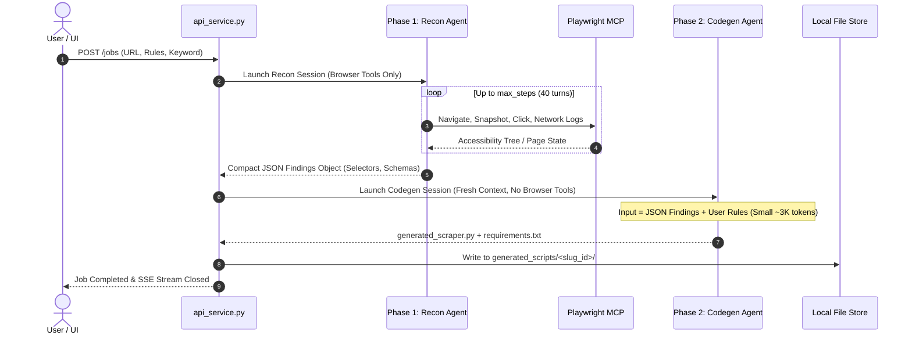

# 🏛️ Scraper Studio — Comprehensive Architecture & Codebase Analysis Report

> **Author:** System Architecture & Agent Engineering Team  
> **Date:** August 28, 2026  
> **Status:** Production Reference Document  
> **Repository:** `mcjohnpaulmc/scraperstudio`

---

## Executive Summary

**Scraper Studio** is an autonomous, unattended web scraper generation platform. It converts plain-English user specifications (search rules, filtering criteria, navigation logic, and extraction schemas) into standalone, production-ready Python scrapers.

Instead of requiring manual browser inspection via DevTools or manual CSS/XPath selector engineering, Scraper Studio orchestrates an autonomous headless browser session using the **Claude Agent SDK** connected over HTTP to a **Playwright MCP** server (`@playwright/mcp`). Claude inspects the target website in real time, discovers data structures, navigates client-rendered layouts, verifies anti-bot signals, and generates a structured Python scraper adhering to a universal runtime contract.

---

## 1. End-to-End System Architecture

```mermaid
flowchart TD
    UI[Frontend: scraper_studio.html] -->|HTTP POST /jobs| API[FastAPI: api_service.py]
    UI -->|SSE GET /jobs/{id}/stream| API
    API -->|Async Task Execution| AGENT[Agent Service: inspection_agent_service.py]
    
    subgraph Agentic Two-Phase Pipeline
        AGENT -->|Phase 1: Recon| RECON[Browser Inspection Session]
        RECON <-->|HTTP MCP Transport / Port 8931| MCP[Playwright MCP Server]
        MCP <-->|Isolated Chromium Profile| WEB[Live Target Website]
        RECON -->|Compact Structured Findings JSON| CODEGEN[Phase 2: Codegen Session]
        CODEGEN -->|Standalone Python + requirements.txt| ARTIFACTS[Generated Scraper Package]
    end
    
    AGENT -->|ResultMessage Telemetry| COST[Cost Metering: cost_metering.py]
    COST -->|Append Record| LEDGER[(cost_ledger.jsonl)]
    API -->|File Persistence| DB[(jobs_store.json)]
    API -->|Isolated Smoke Test| VENV[Local .venv Sandbox]
    VENV -->|Execute Scraper on Real Site| SAMPLE[sample_output.xlsx]
```

---

## 2. The Two-Phase Agent Pipeline (Recon & Codegen)

### 2.1 The Problem in Legacy Single-Phase Systems
In earlier monolithic designs, a single agent session performed both browser navigation and Python code writing. As the agent took accessibility snapshots and collected network logs across 15–20 turns, the context window accumulated massive amounts of HTML and DOM data. 

Because LLM billing charges for cached input tokens on every turn, `cache_read_input_tokens` compounded into 340K–545K tokens per run. 4 out of 5 jobs exceeded the default budget limit ($0.75) and crashed (`error_max_budget_usd`) without producing code.

### 2.2 The Solution: Pipeline Separation



---

## 3. Core Guardrails & Defenses

> [!IMPORTANT]
> **Built-In Spend & Security Controls**
> 
> * **Tool Sandboxing:** The Recon agent is restricted strictly to browser tools (`browser_navigate`, `browser_snapshot`, `browser_click`, `browser_type`, `browser_wait_for`, `browser_network_requests`). Dangerous system tools (`Bash`, `Write`, `Edit`, `Read`) are explicitly forbidden.
> * **Redundant-Call Dedup (`REPEATABLE_WITHOUT_PROGRESS`):** Intercepts `browser_snapshot`, `browser_network_requests`, and `browser_take_screenshot`. If called consecutively with identical parameters, the `PreToolUse` hook denies the call, preventing wasteful token burn.
> * **Anti-Bot Early-Exit:** Monitors all tool outputs for WAF signatures (`cloudflare`, `datadome`, `perimeterx`, `captcha`, `403 forbidden`, `429 too many requests`). If detected, it immediately halts inspection (`status: "anti_bot_detected"`), preserving all prior discoveries.
> * **Fail-Fast Recon Guard:** If Recon fails to gather findings, Phase 2 (Codegen) is aborted immediately to prevent paying twice for a doomed job.

---

## 4. Universal Scraper Script Contract

Every scraper produced by Scraper Studio strictly adheres to a standardized drop-in replacement specification:

| Feature | Technical Specification |
| :--- | :--- |
| **CLI Arguments** | Implements `argparse`: `--input` (default `input.xlsx`), `--output` (default `output.xlsx`), `--max-products` (optional integer limit). |
| **Input Schema** | Standard 3-column format: `keyword`, `listing_url`, and `detail_url`. |
| **Direct Detail Fast-Path** | If a row contains a `detail_url`, the scraper jumps directly to detail page extraction, skipping crawl/search overhead. |
| **Output Schema** | Two-sheet Excel workbook:<br>• **`Extracted Data`**: One row per scraped item with structured attributes.<br>• **`Flags`**: One row per anti-bot signal, DOM anomaly, or network warning. |
| **Anti-Bot Philosophy** | Never attempts to defeat CAPTCHAs. Contains `detect_anti_bot_signals()` to log flags, with `get_proxy()` and `solve_captcha()` preserved as stubs. |
| **Cookie Dismissal** | Browser paths include a `dismiss_cookie_banner(page)` helper executed after every `page.goto`. |

---

## 5. File-by-File Technical Deep Dive

### 1. `auth_config.py` — Credential Provisioning & Validation
* **Supported Backends:** Direct Anthropic API Key (`ANTHROPIC_API_KEY`, checked for `sk-ant-` prefix), Amazon Bedrock (`CLAUDE_CODE_USE_BEDROCK=1`, checks `AWS_REGION`), and Google Vertex AI (`CLAUDE_CODE_USE_VERTEX=1`, checks `ANTHROPIC_VERTEX_PROJECT_ID` and `CLOUD_ML_REGION`).
* **Secrets Management:** Features `get_secret_from_manager()` as an extension point for AWS Secrets Manager, GCP Secret Manager, or HashiCorp Vault.
* **Fail-Fast Boot:** `require_credentials_at_startup()` runs on application startup and crashes the process if credentials are missing, preventing partial configurations from accepting and failing jobs.
* **Security:** Keys are masked (e.g. `sk-ant...7890`) in logs and health check responses.

### 2. `cost_metering.py` — Spend Tracking & Pluggable Sinks
* **Data Structure:** Defines `CostRecord` capturing job ID, session ID, execution timestamp, subtype, total cost (USD), token counts (input, output, cache creation, cache read), turns, and duration.
* **Pluggable Architecture:** Implements `CostSink` ABC. Ships with `JSONLCostSink` (writes to `cost_ledger.jsonl`) and `StdoutCostSink`.
* **Multi-Phase Merging:** `combine_cost_records()` combines Recon and Codegen metrics into a backward-compatible format for the UI, maintaining a detailed breakdown under `phases`.
* **Budget Guards:** Defaults to a $1.50 ceiling per job. Splits budget 70% to Recon and 30% to Codegen, applying an 85% safety margin (`SDK_BUDGET_SAFETY_MARGIN`) before passing limits to the SDK.

### 3. `inspection_agent_service.py` — Core Agent Logic
* **Data Contracts:** Defines `InspectionJob` (input configuration) and `InspectionResult` (output artifact).
* **MCP Integration:** Connects to Playwright MCP via HTTP transport (`http://localhost:8931/mcp`) with `--isolated` profile flags.
* **Hooks Engine:** `build_hooks` implements real-time audit logging, SSE push callbacks, turn caps, and duplicate tool call interception.
* **Multi-Tier Robust Parsers:**
  * `parse_agent_output`: Extracts code via Tier 1 (raw JSON), Tier 2 (````json```` block), Tier 3 (````python```` block), or Tier 4 (safe failure fallback, never saving unparsed prose as Python code).
  * `parse_recon_output`: Layered parser for structured recon findings.

### 4. `api_service.py` — FastAPI REST & SSE Layer
* **Endpoints:**
  * `POST /jobs`: Creates an inspection job and launches background execution.
  * `GET /jobs`: Retrieves all historical and running jobs for the dashboard.
  * `GET /jobs/{id}`: Returns status, generated code, requirements, and confidence notes.
  * `GET /jobs/{id}/stream`: Server-Sent Events (SSE) endpoint streaming real-time browser actions.
  * `GET /jobs/{id}/cost`: Standalone endpoint for cost telemetry.
  * `GET /health`: Health verification endpoint.
  * `POST /jobs/{id}/test-run`: Sets up an isolated virtual environment (`.venv`), installs `requirements.txt`, creates `sample_input.xlsx`, and runs the generated script against the live target.
  * `GET /jobs/{id}/sample-output`: Downloads the generated `sample_output.xlsx`.
* **Durability:** `JobStore` provides file-backed persistence to `jobs_store.json` using an async lock.
* **Disk Output:** Automatically saves generated scrapers to `generated_scripts/<slug_jobid>/generated_scraper.py`.

### 5. `scraper_studio.html` — Interactive Web UI
* **Design Aesthetic:** Dark developer-console theme using Inter and JetBrains Mono (`#0a0d12` background, `#4fd1a5` mint accent, amber and red alert tags).
* **Views:**
  1. **Home:** Platform overview, statistics, activity feed, and live backend connection tester.
  2. **Builder:** Job submission form with client-side Excel parsing via SheetJS (`xlsx.full.min.js`) for automatic keyword and URL extraction.
  3. **Scraper Detail:** Real-time agent log streamer, tabbed code viewer, flagged issues panel, test-run controller, and run instructions.
  4. **Dashboard:** Tabular job repository displaying target sites, timestamps, status tags, and anti-bot alert badges.
* **Offline Demo:** Includes a pre-configured Samsung smartphone scraper demo with animated simulated execution traces when offline.

---

## 6. How to Run Scraper Studio Locally

### Step 1: Start the Playwright MCP Server
```bash
npx @playwright/mcp@latest --port 8931 --host 0.0.0.0 --isolated
```

### Step 2: Launch the API Backend
```powershell
pip install -r requirements.txt
$env:ANTHROPIC_API_KEY="sk-ant-your-key-here"
uvicorn api_service:app --host 0.0.0.0 --port 8000
```

### Step 3: Launch the Frontend
Open `scraper_studio.html` in your web browser. Click **Test connection** on the Home tab to verify connectivity, then build scrapers via the Builder interface!
